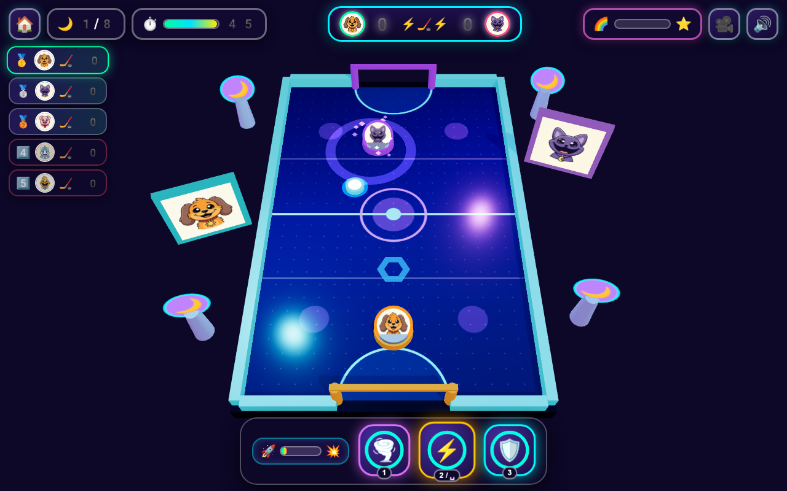

# 🏒 Critter Air Hockey 3D: Neon Stadium Smash! ⭐

**Play Live:** [https://kunruiw1991.github.io/critters-hockey3d/](https://kunruiw1991.github.io/critters-hockey3d/)  
**Repository:** [https://github.com/kunruiw1991/critters-hockey3d](https://github.com/kunruiw1991/critters-hockey3d)



A vibrant, kid-friendly **3D WebGL Arcade Air Hockey & Stadium Tournament** built with **Three.js (r161)**, custom procedural Web Audio synthesizer sound effects, tactile 3D collision physics, and all **8 Smiling Critters**!

---

## ✨ 3D Engine & Gameplay Highlights

- **8 Playable Smiling Critters (`icons/*.jpg`)**:
  - Pick from **Bubba Bubbaphant** (`🐘`), **Bobby BearHug** (`🐻`), **CatNap** (`🐱`), **CraftyCorn** (`🦄`), **DogDay** (`🐶`), **Hoppy Hopscotch** (`🐰`), **KickinChicken** (`🐥`), or **PickyPiggy** (`🐷`)!
  - Upright 3D Portrait Medallions (`THREE.Sprite` billboards) ride above every mallet on the rink alongside the arena's dual rival & player 3D Jumbotrons.
- **Full 3D Neon Stadium & Dynamic Camera Rig**:
  - Perspective 3D arena with specular ice reflections, glowing neon goal arches, animated rink border pulse strips, 3D star obstacle bumpers, and 3 camera presets (`📷` Broadcast, Close Action, Overhead) fitted dynamically to every desktop or mobile viewport.
- **Tactile 3D Physics & Collision Feedback**:
  - Sub-stepped 240Hz circle-circle & segment-circle collision solver with mallet velocity transfer (`1.38x`), 3D mallet recoil impulses, expanding neon shockwave rings, spark bursts, floating 3D score popups (`+1⭐`, `+2⭐`), and flying 3D star coins that arc into the HUD star counter.
- **100% Zero-Text Kid-Friendly Visual Cockpit**:
  - Icon-only HUD gauges, graphical segmented stat bars (`⚡` Speed, `💥` Power, `🧲` Magnet), real-time slapshot swing-speed gauge (`🏏`), and giant touch-friendly controls.
- **3 Interactive Power Pedals + Rainbow Fever Mode (`🌈`)**:
  - **Pedal 1 (`🌪️` Vortex / Key `1`)**: Spawns a 3D swirling vortex attractor inside the open corner of the rival's goal mouth that curves pucks away from the goalie!
  - **Pedal 2 (`⚡` Fire Slapshot / Key `2`)**: Ignites a 3D golden flame aura around your mallet and turbo-boosts your next slapshot (`1.58x` velocity)!
  - **Pedal 3 (`🛡️` Goal Shield / Key `3`)**: Raises a shimmering 3D forcefield wall across your goal mouth for 4.5 seconds!
  - **Rainbow Fever (`🌈` / `Space`)**: Charges on hits, star collects, and goals — unleashes a 6-second Rainbow Overdrive with multi-puck chaos, 2x star points, and a 360° rainbow stadium light show!

---

## 🏆 5-Critter Tournament & Top-3 Qualification Rules

Every match pits **you against 4 AI Critter Rivals** in a 5-Critter tournament leaderboard:
- **Goal Scored**: **+2 ⭐** (or **+4 ⭐** during Rainbow Fever `🌈`!)
- **3D Star Token / Bumper Collected**: **+1 ⭐** (or **+2 ⭐** during Rainbow Fever `🌈`!)

| Final Rank | Medal & Stars | Tournament Outcome |
| :--- | :--- | :--- |
| **1st Place** (`🥇`) | `👑 ⭐⭐⭐` (3 Stars) | **Victory!** Unlocks the next Neon Stadium stage! |
| **2nd Place** (`🥈`) | `⭐⭐` (2 Stars) | **Qualified!** Unlocks the next Neon Stadium stage! |
| **3rd Place** (`🥉`) | `⭐` (1 Star) | **Qualified!** Unlocks the next Neon Stadium stage! |
| **4th / 5th Place** (`😢`) | `0 ⭐` | **Sad Defeat Screen** — Stage remains locked; tap the pulsing **Retry (`🔄`)** button to try again! |

---

## 🏟️ 8 Distinct Neon Stadium Stages

| Stage | Icon | Stadium Theme | Arena Obstacles & Mechanics | Rival Goalie |
| :---: | :---: | :--- | :--- | :--- |
| **Stage 1** | `☀️` | **Sunny Meadow Rink** | Open rink, gentle beginner AI (`8.2` speed), bonus star spawns | `🐷` PickyPiggy |
| **Stage 2** | `🍭` | **Candy Cloud Arena** | 2 candy bumper pillars (`🍭`) that award `+1⭐` on bounce | `🐻` Bobby BearHug |
| **Stage 3** | `❄️` | **Frosty Crystal Dome** | High-speed low-friction glacier ice + 2 crystal bumpers (`❄️`) | `🐘` Bubba Bubbaphant |
| **Stage 4** | `⚡` | **Neon Thunder Bowl** | Central electric bumper (`⚡`) + periodic dual-puck spawns | `🐥` KickinChicken |
| **Stage 5** | `🌙` | **Lavender Dream Rink** | 3 starlight bumpers (`🌙`) + fast multi-puck rallies | `🐱` CatNap |
| **Stage 6** | `🌈` | **Rainbow Prism Court** | 4 prism bumpers (`🌈`) + rapid star token waves | `🦄` CraftyCorn |
| **Stage 7** | `🔥` | **Turbo Hopper Stadium** | 3 turbo bumpers (`🔥`) + high-velocity counter-lunging AI | `🐰` Hoppy Hopscotch |
| **Stage 8** | `👑` | **Grand Champion Finale** | 4 golden bumpers (`👑`) + fast multi-puck championship showdown | `🐶` DogDay |

---

## 🔄 10-Round Iterative Critic-Creator Refinement Changelog

1. **Round 1 — Initial 3D Stadium & Core Engine**: Built Three.js WebGL arena, 8 Smiling Critters character picker, 8 stages, 3 power pedals, procedural Web Audio synth, and 5-critter tournament leaderboard.
2. **Round 2 — Dynamic Camera Frustum Fitting & Lighting**: Added mathematical bounding-box camera fitting (`fitCameraToRink`) so both goals and the scoreboard remain 100% visible across all aspect ratios, plus improved shadow bounds and crisp portrait anisotropy.
3. **Round 3 — Upright 3D Portrait Medallions & Stage Palettes**: Replaced flat decals with upright `THREE.Sprite` portrait medallions with custom canvas radial badges on both mallets, repositioned the rival 3D Jumbotron cleanly clear of the HUD, and gave all 8 stages bespoke 3D sky domes, ice shaders, and obstacle geometries.
4. **Round 4 — Tactile 3D Physics & Collision Impact**: Upgraded camera shake to post-lerp angular/positional trauma, added 3D mallet recoil impulses (`recoilVx`/`recoilVz`), multi-layered shockwave rings, and 3D flying star coins that arc into the HUD star pill.
5. **Round 5 — 100% Zero-Text Kid-Friendly Visual Cockpit**: Replaced text labels with graphical segmented stat bars, added a real-time mallet swing-speed gauge (`#swing-gauge-pill`), pulsing `.ready` pedal states, and an interactive `#fever-meter-pill` button.
6. **Round 6 — 3D Power Pedal Meshes & Rainbow Fever Overdrive**: Added a dedicated 3D swirling vortex torus-ring + funnel mesh for Pedal 1 (`🌪️`), an unlit additive energy rim for Pedal 3 (`🛡️`), and a 360° rainbow stadium light & border cycle during Fever Mode (`🌈`).
7. **Round 7 — AI Goalie Intelligence & Stage 1 Calibration**: Calibrated Stage 1 for an encouraging 3-star beginner win, added AI goalie counter-strike lunges and corner-trap protection, and made Pedal 1 (`🌪️` Vortex) dynamically target the open side of the rival's net.
8. **Round 8 — Strict Top-3 Podium & Defeat State Polish**: Added explicit rank guards on `#btn-result-next`, `.defeat-card` magenta styling with pulsing `#btn-result-retry`, crown/star badges on the 3D/2D podium plinths, and live qualification cutline badges in the HUD.
9. **Round 9 — Web Audio Synth Polish & Mobile Viewport Ergonomics**: Added a dedicated `feverChime()` arpeggio, `matchLaunch()` stadium horn, descending sawtooth trombone slide on defeat, and responsive `@media (max-width: 540px)` and `@media (max-height: 500px)` rules.
10. **Round 10 — Edge-Case Guardrails & Memory Pool Hygiene**: Added horizontal puck stall detection (`stallTimer`), automatic `blur`/`visibilitychange` input & audio safety, and full object-pool cleanup (`clearTransientEffects()`) across stage transitions.

---

## 🚀 Running Locally

```bash
python3 -m http.server 8907
# Open http://localhost:8907 in your browser
```
